<div align="center">


# Kolibre

**A self-hosted home for everything around your reading.**

Your library, your devices, your highlights and your reading history —
in one place, on your own machine.

</div>

---

Kolibre started as a home-server library manager with one goal: **centralise everything
that surrounds reading, and get out of the way of the reading itself.**

It keeps your books, pushes them to your e-readers and takes them back, collects what you
highlighted and how long you read, and knows who wrote what. It is not a reading app. It
is the place everything else happens, so that the reading app can stay a reading app.

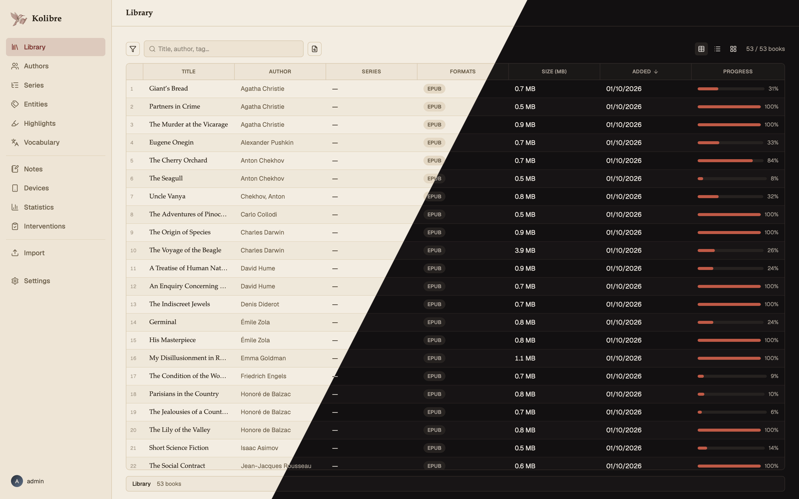

---

## The reading flow

This is the loop the whole program is built around. Four steps, and you only touch two of
them.

**One page for the library.** Clean, complete, fast — every book, every author, every
format, nothing you have to go and look for somewhere else. From here you send a book to
your e-reader: you choose on the server, and that is the last decision you make.

**Then you read.** On the device, in KOReader, with nothing in the way. No app asking you
to rate it, no sidebar, no sync button to remember. Just the book.

**Everything comes back on its own.** Where you got to, how long you read, what you
highlighted, the words you looked up. By the time you put the device down the server
already knows, and the library page shows it.

**Then you open Obsidian**, and your highlights are there — in your vault, as Markdown,
under the book's own chapters, next to everything else you write.

That is the whole thing. The e-reader stays a reading app, your notes stay where your notes
live, and the part in the middle — the part that is usually manual, and usually abandoned
after a month — is the part Kolibre does.

---

## Contents

- [The reading flow](#the-reading-flow)
- [Why Kolibre exists](#why-kolibre-exists)
- [How it is organised](#how-it-is-organised)
- **The pages**
  - [Library](#library)
  - [Book detail](#book-detail)
  - [Authors](#authors)
  - [Series](#series)
  - [Annotations](#annotations)
  - [Vocabulary](#vocabulary)
  - [Notes](#notes)
  - [Devices](#devices)
  - [Statistics](#statistics)
  - [Entities](#entities)
  - [Interventions](#interventions)
  - [Import](#import)
  - [Settings](#settings)
- **Integrations**
  - [KOReader](#koreader--the-one-that-matters)
  - [Calibre](#calibre--because-it-is-still-the-best-editor)
  - [Obsidian](#obsidian--notes-where-you-actually-keep-them)
  - [A link you can paste](#a-link-you-can-paste)
- [Install](#install)
  - [Using a Calibre library you already have](#using-a-calibre-library-you-already-have)
- [Large libraries](#large-libraries)
- [Roadmap](#roadmap)
- [A note of modesty](#a-note-of-modesty)
- [Project status](#project-status)
- [Security](#security)
- [Credits](#credits)
- [Contributing](#contributing)
- [Repository layout](#repository-layout)
- [License](#license)

---

## Why Kolibre exists

**An e-reader should be boring.** It is slow, its screen refreshes in a blink of grey, and
that is exactly its virtue: there is nothing to do on it except read. Browsing a catalogue
of two thousand books on an e-ink screen is a bad experience *and* a bad idea — it turns a
reading device into a thing you flick through.

So the browsing, the choosing, the sorting, the statistics and the second-guessing belong
somewhere else: on a real screen, with a real keyboard, where that kind of work is
pleasant. The e-reader gets told what to carry, and carries it.

| On your server | On your e-reader |
|---|---|
| The whole library, searchable | The handful of books you are actually reading |
| Covers, metadata, authors, series | No catalogue to get lost in |
| Highlights, notes, reading statistics | Reading. That is it. |
| You decide what goes on the device | The device applies that decision |

Two things follow from that division of labour, and they run through the whole program.

**Kolibre is a service, not a desktop application.** It is meant to live on a machine that
is always on — a home server, a NAS, an old laptop in a cupboard — and to do its work while
nobody is looking at it. The syncs run in the background: you choose a book at your desk in
the afternoon, and when you switch the e-reader on in the evening the book is simply there.
A program you open on a computer cannot do that, because the moment the device asks is
exactly the moment that program is closed.

**A Kolibre library is a Calibre library** — not a copy of one, not an import of one.
Kolibre writes `metadata.db` using Calibre's own sorting and folder-naming algorithms,
ported line by line (see [NOTICE](NOTICE)), so the same folder opens in Calibre Desktop with
no conversion step, and the two can be used side by side. The fidelity is not only on disk:
custom columns are Calibre's custom columns, and a plugin lets Calibre itself send books
straight into a Kolibre library. You keep using Calibre for the things it is still better
at, you can point Kolibre at a library you already have without copying it, and if you stop
using Kolibre the folder is exactly what it was.

Put the two together and you have the shortest description of what this is: **Calibre moved
onto your local network**, with the e-readers, the devices and the notes that a network
makes possible built around it.

---

## How it is organised

```
  ┌─────────┐        ┌───────────┐        ┌───────┐        ┌─────────┐
  │  Users  │───────▶│ Libraries │───────▶│ Books │───────▶│ Authors │
  └─────────┘ owns / └───────────┘        └───────┘        └─────────┘
       │       shares      ▲                   ▲                 ▲
       │                   │                   │                 │
       │              a real Calibre      highlights,        Wikipedia
       │              metadata.db         notes, sessions    + Wikidata
       │                                       │
       │              ┌─────────┐              │
       └─────────────▶│ Devices │──────────────┘
          registers   └─────────┘   holds a subset,
                                    reports back what you read
```

- **Libraries** are real [Calibre](https://calibre-ebook.com) libraries — same
  `metadata.db`, same `Author/Title (id)/file` layout on disk, same custom columns. Kolibre
  has no format of its own, and never will.
- **Users** see the libraries they own or that were shared with them, with read or write
  permission. A user with no libraries is told so, instead of being shown an empty one.
- **Devices** are paired e-readers. Kolibre tracks what each one holds and what it *should*
  hold, and the difference is the sync.
- **Authors** are shared across libraries: the same person is one author, whether their
  books sit in your personal library or in an archive.

**If you are one person with one library, you never see any of this.** The library picker,
the permission screens and the sharing dialogs appear when a second library or a second
person does. The simple case stays simple.

**The web interface is a client, not the program.** Kolibre runs as two halves — a backend
that holds the library and answers over HTTP, and a web app that asks. That costs more than
one program would, and it buys one thing: nothing can hide in the browser. The backend serves
no interface of its own — only JSON, files and OPDS feeds — and four clients that are not a
browser already speak to it: the KOReader plugin, the Calibre plugin, the Obsidian plugin, and
any OPDS reading app. Logging in returns a bearer token, not a browser session,
and the whole contract is published as OpenAPI, which is where the web app's own types are
generated from.

So a native client for macOS, Windows, Linux or Android could talk to a Kolibre server
without the web app in front of it. That is not a promise — the web app is convenient,
reachable from any device, and will stay. It is the reason for the split: a rule that lives
in the browser is a rule the next client will contradict, so rules about your library belong
in the server, and the browser only draws.

---

## The pages

### Library

The catalogue, and the page you will spend most time in.

**Three views, because they are three different jobs:**

| View | For |
|---|---|
| **Table** | Scanning and sorting hundreds of rows. Configurable columns, multi-level sort, row selection |
| **Grid** | Browsing covers, when you do not know what you are looking for |
| **List** | Narrow screens — compact rows with a small cover |

**Finding things**

- **Search** across title, author, series, tags, publisher
- **Full-text search** inside the actual content of your books, with the matching passage
  shown in context
- **Navigator** — a filter tree built from the real values in the library (authors, tags,
  series, languages, formats, ratings), with counts. Click to narrow, click again to widen
- Sorting is **multi-level**: sort by author, then by series, then by volume, and the
  previous order survives inside each group

**Doing things**

- **Bulk edit** — change tags, series, publisher, rating or read status on a selection
- **Send to device** — queue books for any paired e-reader
- **Quickview panel** — a resizable side panel with the selected book's details, without
  leaving the list
- **Context menu** on any row: edit, convert, send, open in reader, delete

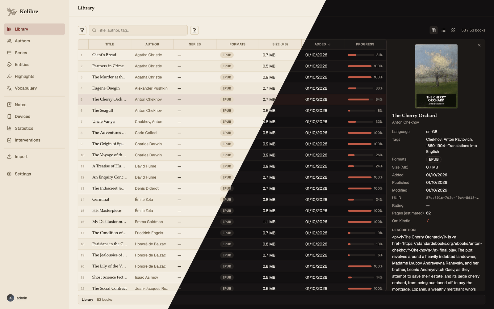

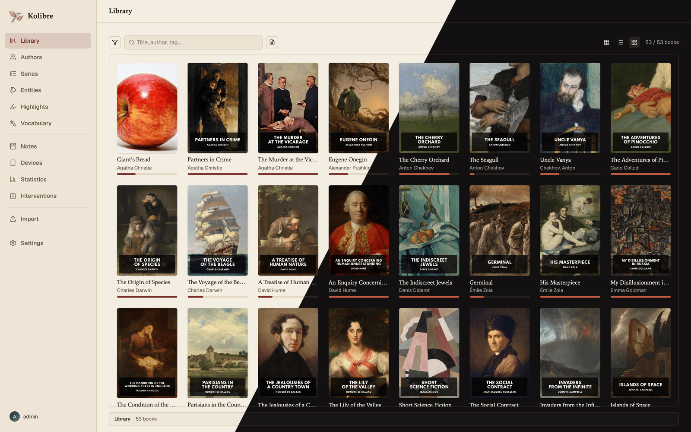

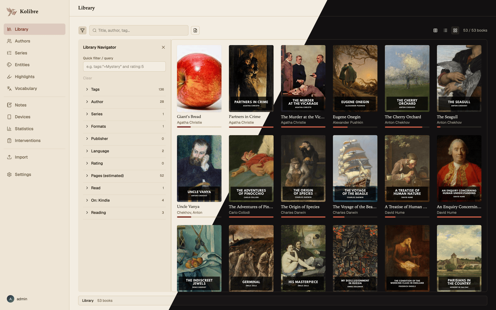

> **Web reader** — Kolibre can open EPUB and PDF in the browser, with text selection,
> highlighting, search, themes and position sync back to your devices. It is **still
> rough**, and — at least for now — deliberately not the point: it exists for checking a
> passage from your desk, not for reading a novel. A reader solid enough for a whole book is
> the first thing on the [roadmap](#roadmap).

### Book detail

One page per book, with everything the file and the library know about it.

- Every metadata field, editable in place, including Calibre custom columns
- **Formats** — add, remove, convert between them (Calibre's `ebook-convert` under the
  hood, when available)
- **Cover** — replace it, or let Kolibre build a readable one for books that have none
- **Table of contents** — inspect it, regenerate it, or anchor entries by hand when a badly
  produced EPUB has none
- **Metadata search** online, with a side-by-side comparison before anything is written
- **Reading progress and coverage** — how much of this book you have actually been through,
  measured in characters rather than "pages", which depend on the font size
- **Highlights** from every device, inline

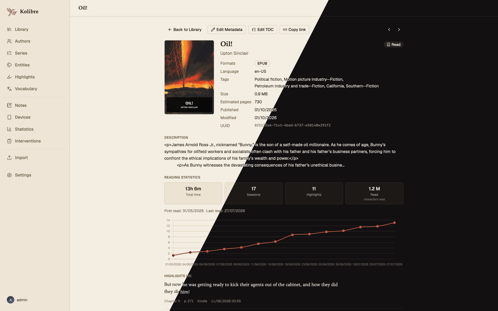

### Authors

Every author in your libraries, as a grid of portraits or a sortable table — and the view
you chose is remembered.

- **Biography, dates, nationality, occupations and photo**, fetched automatically from
  **Wikipedia and Wikidata** where they can be found
- Anything missing can be written by hand, and anything wrong corrected — including
  pointing the fetcher at a specific Wikipedia page when the automatic match picks the
  wrong person
- **Photo** from a Wikimedia Commons search, from a pasted image address, or uploaded
- **Per-author reading statistics**: how long you spent with them, how many of their books
  you finished
- An A–Z index down the side when the list is alphabetical


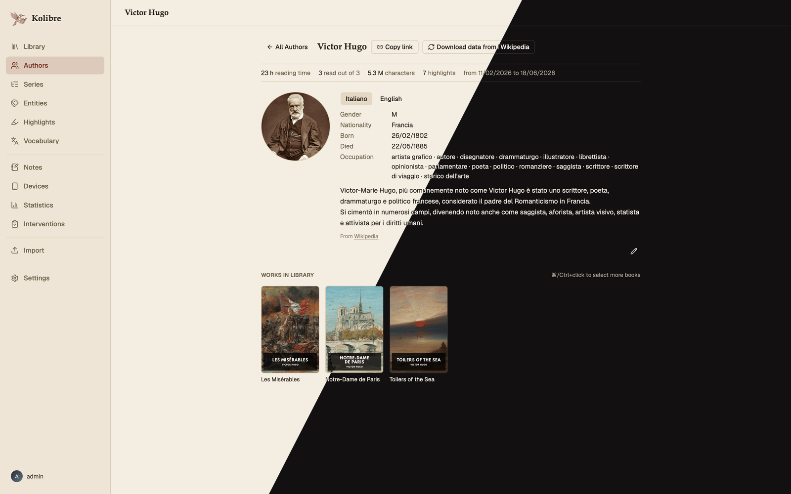

### Series

Which series you own, which volumes are missing from the numbering, and where you stopped.
Series can also be dissolved — the books stay, they just stop belonging to it — or turned
into a tag.


### Annotations

Every highlight and note from every device, in one place, **searchable inside the text**,
with the matching words marked in the passage itself.

Three ways to look at the same set, because they answer different questions:

| View | Answers |
|---|---|
| **Reading** | "Show me something I forgot I marked" — one passage after another, nothing else on screen |
| **Shelf** | "Everything from the book I just finished" — a card per book, with a taste of what is inside |
| **Index** | "That one passage I remember" — a narrow list beside the full passage |

- Your own **notes** on any highlight, kept separate from the quoted text
- **Open in the reader** at the exact position — and when the anchor no longer holds
  (re-imported file, failed conversion), Kolibre finds the passage by its text instead
- **Export** to Markdown or HTML, one file or one per book
- A **trash**, because deleting is a decision too: deletion asks first, and is undoable

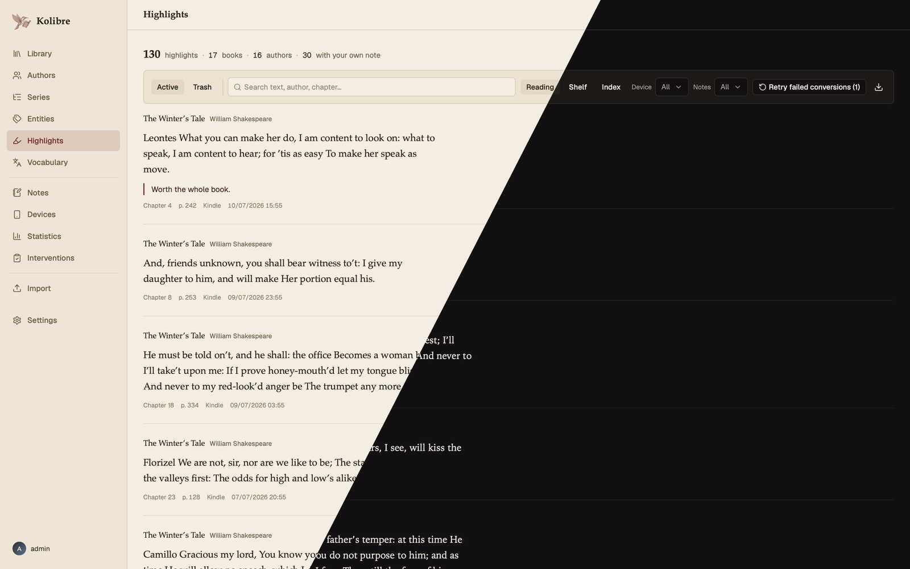

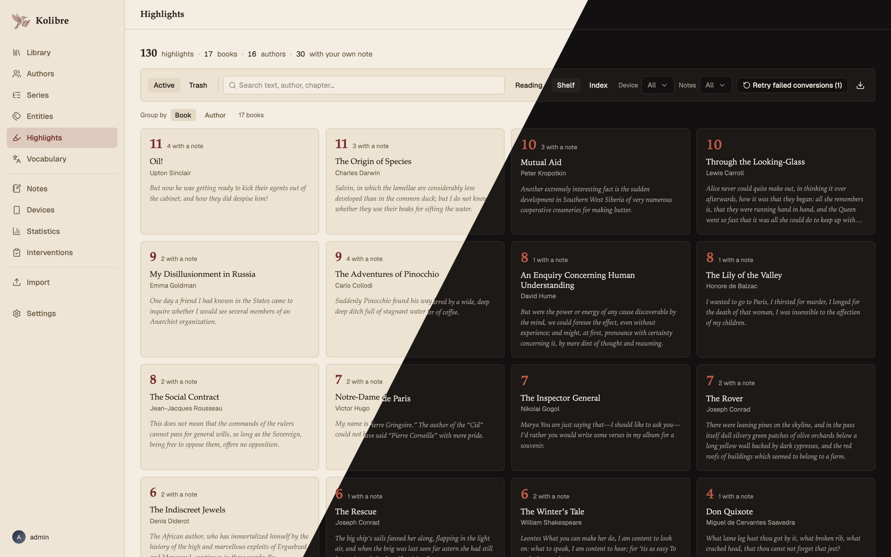

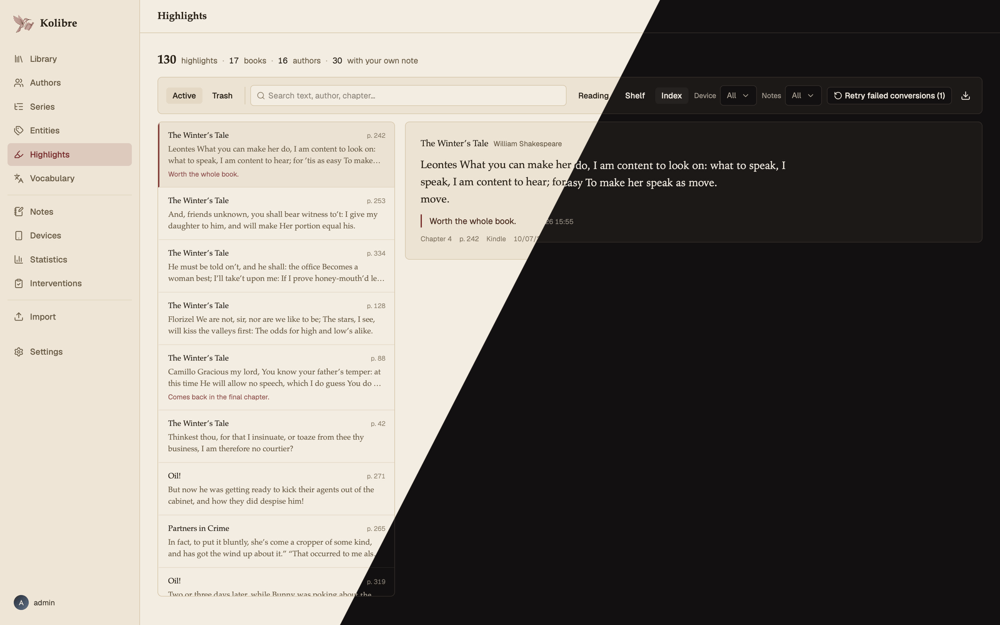

### Vocabulary

The words you looked up on the device while reading, collected instead of lost — with the
book and the passage they came from, and definitions from offline StarDict dictionaries
that Kolibre can install for you.

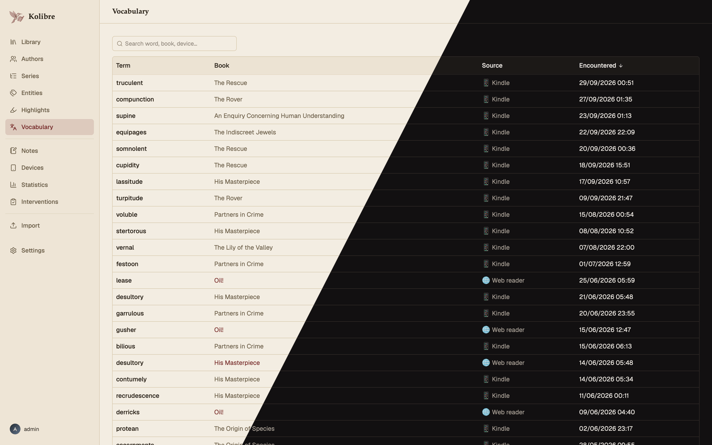

### Notes

Your highlights do not have to live in Kolibre. This page is the server's half of that
bridge: a searchable table of your books, each one's state in the application that keeps the
notes, and how many highlights made it there. Open a book and you get its highlights one by
one, searchable and filterable too, each with its own state — never delivered, up to date,
changed in Kolibre, edited by you, removed by you, in conflict.

**Today that application is Obsidian**, through the
[plugin described below](#obsidian--notes-where-you-actually-keep-them), which is the only
thing that speaks this protocol so far. But the server does not know the word Obsidian: what
it records is *a client*, recognised by the token it talks with, that reports what it is
holding. Several can exist side by side, and the page lets you pick which one you are
looking at. Another note-taking application — a second vault, a plain folder of Markdown,
something nobody has written yet — could use this page with no change on the server. That is
how it is built, not a promise about what will exist.

Three decisions live here, and **none of them is an immediate action**: Kolibre cannot write
into your vault, so what you choose is an instruction the client carries out on its next
run, and the page says so.

- **Stop sending it** — the client stops updating that file. The file that is there stays
  where it is.
- **Rebuild it** — the file is rewritten from Kolibre's highlights. It is the one action
  that throws away something of yours, and it asks first, in as many words.
- **Who wins a conflict** — the two passages side by side, with the differences highlighted
  word by word, and two buttons. "Keep mine" does not merely do nothing: it moves the
  marker, so the same question is not asked again at every sync.

The page shows up once a client has reported something — an empty room does not need a door
— unless you put it in the sidebar yourself from *Settings → Appearance*, in which case it
stays. Something you chose by hand is not for the program to undo.

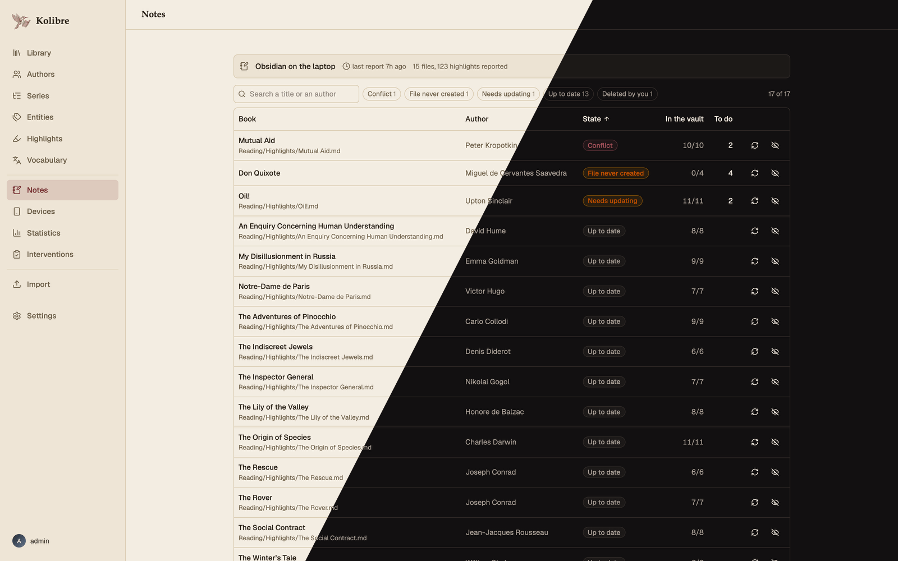

### Devices

One card per paired e-reader.

- What it currently holds, and what is queued to be sent or removed
- **Free space** on the device, reported by the plugin at every sync
- **Plugin version**, with a line telling you which devices are behind
- **Sync history** that says *what actually happened* in words — "4 books received · 2
  removed · 118 reading rows · notes and positions sent" — instead of six columns of
  numbers where a zero and a never-ran look the same
- **Backups** of the device's own KOReader configuration and statistics
- **Needs review** — books the device reports that Kolibre could not match to anything in
  your libraries

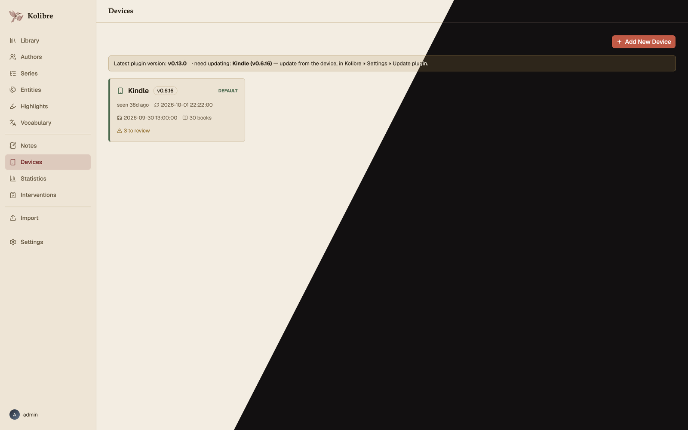

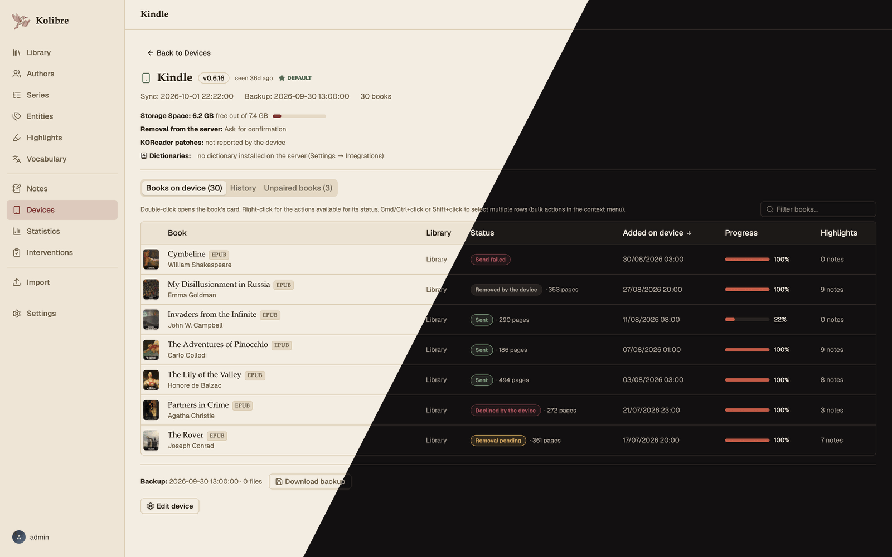

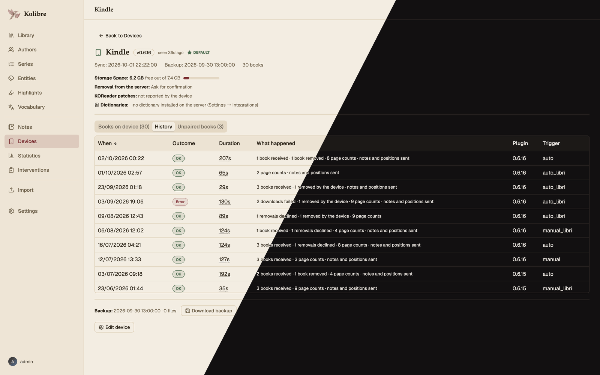

### Statistics

Two halves that answer two different questions.

**Library — what you own**

Formats and the space they take, book lengths, languages, tags, ratings, top authors and
series. Plus what the author data makes possible: **which era your authors were born in,
where they came from, what they did for a living.**

**Reading — what you did**

Scoped to all libraries at once, because "how much have I read in my life" is not a
property of a folder.

- Time read, characters read, books finished, current streak
- **Personal records**: best year, longest book, longest streak, the author you spent most
  time with
- **Per-day histogram** and a **ten-week histogram**, each switchable between minutes and
  characters — the two measure different things: minutes say how much *time* a book took,
  characters how much of it you *covered*
- A **year heatmap**, and a **reading calendar** that puts the actual book titles inside
  each day, with the time spent
- **Always-on statistics** that ignore the period filter because the question does not
  depend on it: characters by hour of the day, reading speed by hour, the fastest and
  slowest books you read, the ten authors you spent most time with, and the books you
  finished broken down by their author's birth decade, trade and country
- A **custom chart builder** for anything not covered

Where a number would be misleading, it is not shown: a reading speed computed from four
minutes of data says more about the sample than about you, so it is excluded and the page
says how many were excluded.

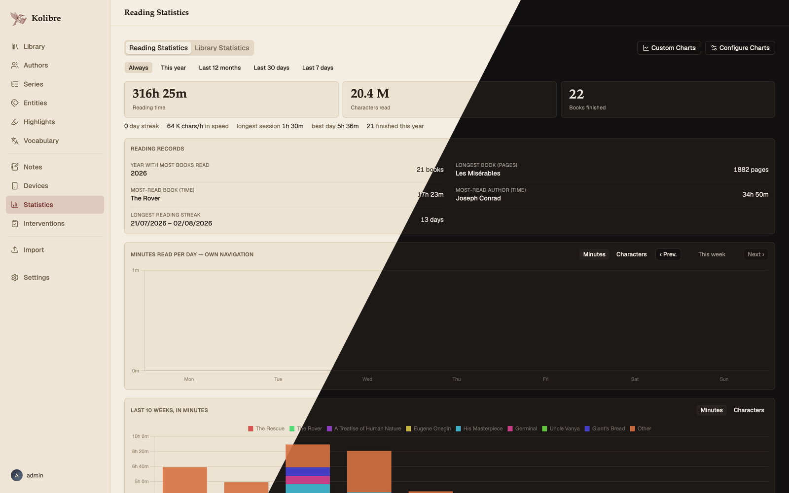

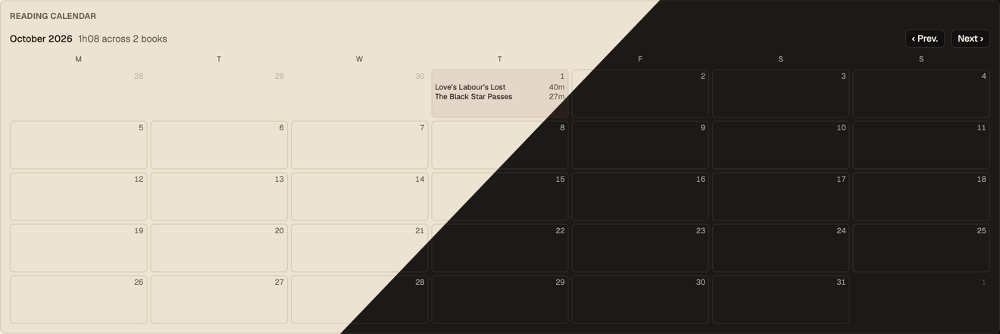

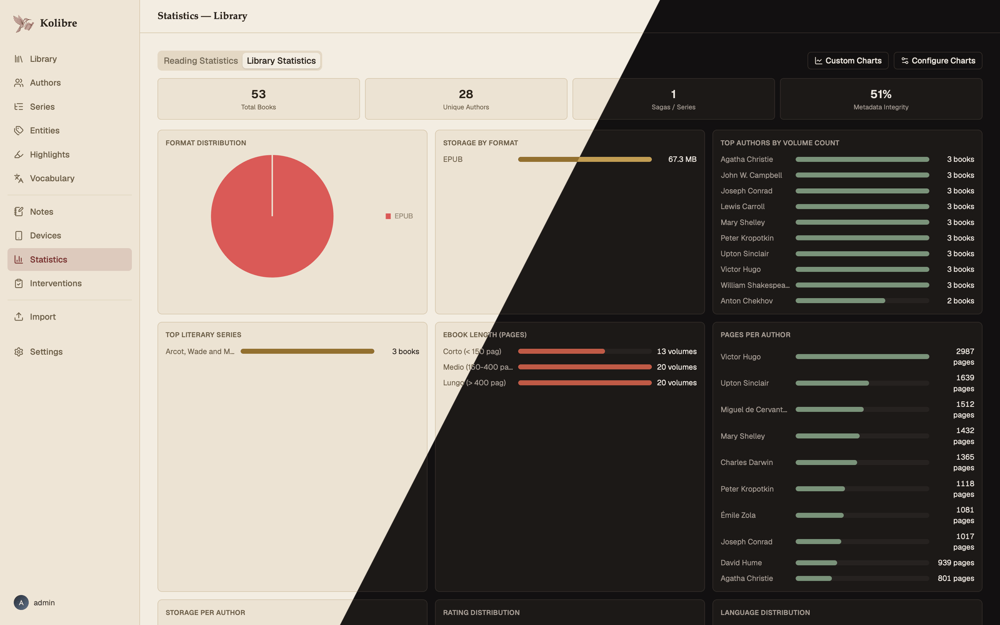

### Entities

Authors, series, tags and publishers are the names that hold a library together, and in a
real library they are a mess: `Cortázar, Julio` and `Julio Cortazar`, `Aa. Vv.` and
`AA. VV.`, the same publisher spelled three ways.

- Finds the **duplicate spellings** and proposes a merge, **across every library at once** —
  disorder in names does not stop at a folder boundary
- The suggested spelling is the one an **online source recognises**, not the one with the
  most books: the number of books knows nothing about how a name is written
- Merging rewrites every affected book **and moves the files on disk** to match
- Tells you the state of each author's data — biography, photo, facts — as sortable
  columns, so you can see who still needs looking up
- You can also say **"these two are different people"**, and it remembers. Giuseppe Berta
  is a historian and Giuseppe Berto a novelist; no algorithm will ever know that

The same page is built for two fairly different jobs. One is a personal library of a few
hundred or a few thousand books, where tidying up is occasional and rather pleasant. The
other is a very large collection — an archive, someone else's library you inherited — where
the names arrive in whatever shape they were in and the only way through is in bulk: find
every spelling at once, merge in one operation, and have the folders on disk follow. That is
why every action here is offered both one at a time and across every library together.

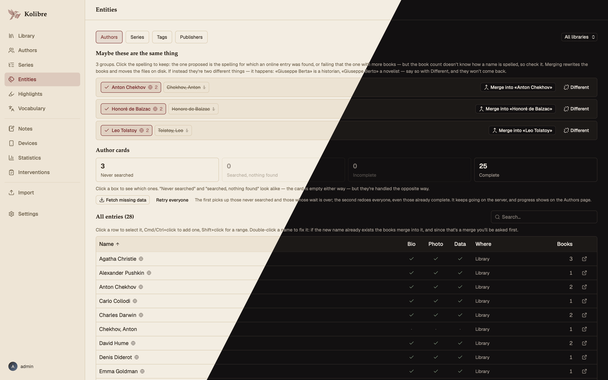

### Interventions

Everything that needs a decision, in one queue, so that nothing is decided behind your
back. **The software proposes and a person decides**: a duplicate is not discarded on its
own, a note whose anchor broke is not thrown away, and a book is not marked read because a
percentage says so. The queue is grouped by what the decision is about, and a group with
nothing to say does not appear at all.

**The books**

- **Possible duplicates** inside a library, compared by metadata, then by file hash, then
  by a quality score. Merging makes the loser hand over its highlights, reading sessions and
  positions; you can also declare two books different for good. Where the files are
  byte-for-byte identical the choice is mechanical and every such group can be merged in one
  go — where they differ, you choose, because the evidence that they are the same book is a
  similarity of title and that can be wrong
- **Books that look read** — coverage says you finished them, but the checkbox is yours to
  tick

**The annotations.** Three states that look alike and are kept apart on purpose, because
they are repaired in different places:

- **Notes left without a book** — they point at a book that is no longer there, and they are
  reconnected from here
- **Notes without a book at all** — highlights a device reported for a file Kolibre never
  recognised; these are paired from the device's own page, where the file is
- **Notes that lost their place** — they have a book, but no position inside it

**The devices**

- **Books the library no longer has** — rows the server still counts on a reader, for books
  that left the library by a route that did not pass through Kolibre (deleted in Calibre
  Desktop, lost in a move). You can queue the removal on the device, or just drop the row
  from the count and let the device's *Initialize library* offer what to do with the file
- **The link with your readers** — a check you ask for rather than a problem you are shown.
  To recognise a book, a reader and the server compare a fingerprint of the file; a
  fingerprint that was not redone describes a file that no longer exists, and the result is a
  note nobody can place. There is no error to notice, which is exactly why there is a button.
  This entry is always present, because the place to ask for a check has to exist before you
  know you need one

And, when there are any, **reading sessions without a book** — time read that the server
could not attribute to anything.

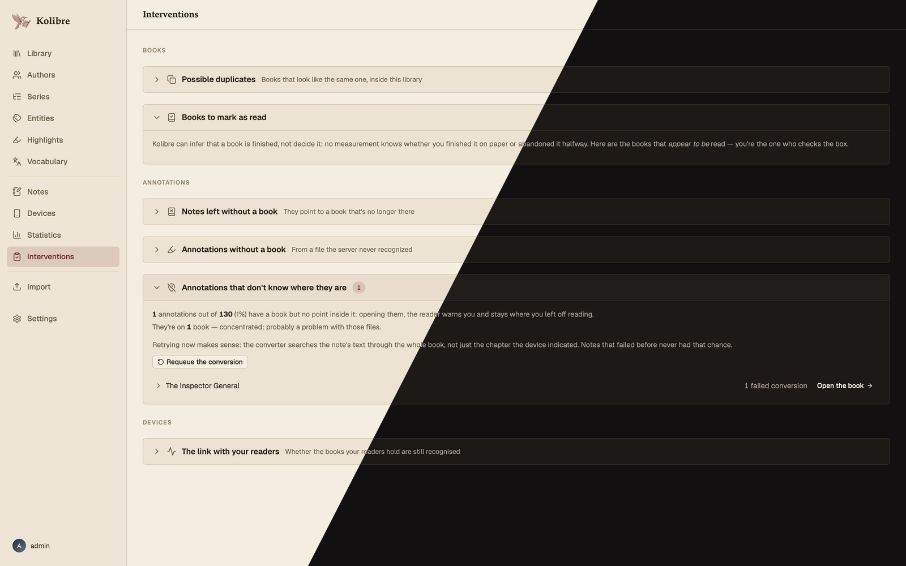

### Import

A watched folder: drop files in, and Kolibre stages them instead of importing blindly.

- Metadata read from the file itself, cover extracted, both editable before import
- **"You may already have this"** — a possible duplicate is flagged before it gets in, not
  after
- Import one, a selection, or everything, into any library you can write to

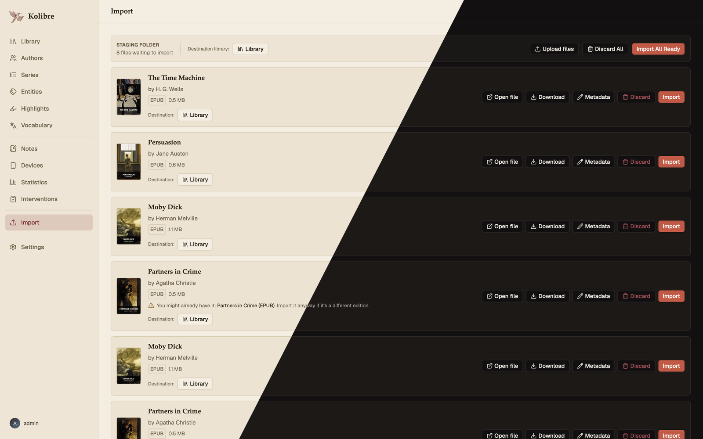

### Settings

Not a page but a panel over whatever you were looking at, so that changing a setting does
not cost you your place in the list. Eight sections, in four groups:

| group | sections |
|---|---|
| **General** | Profile · People · Appearance |
| **Content** | Libraries · Bulk operations |
| **Connections** | Devices · Integrations |
| **Advanced** | System |

- **Profile** — your account, your password, and **application tokens**: a named key you
  create here and see exactly once, revocable from the same list, for anything that talks to
  the server without a browser
- **Libraries** — create, import an existing Calibre folder, share with another user with
  read or write permission, full-text indexing per library
- **People** — accounts and what each one may do: create libraries, register devices,
  manage others
- **Appearance** — the interface language, English or Italian; the plugins you download
  from here are packaged in that language too. And **ten themes** chosen as a *pair*: one
  light, one dark, plus the rule that decides which is active — follow the operating
  system, or pick one and stay there. Then cover size, table density, date format, and a
  drag-and-drop builder for the sidebar
- **System** — keyboard shortcuts, server log, maintenance commands, the running version,
  and everything described under [Large libraries](#large-libraries)

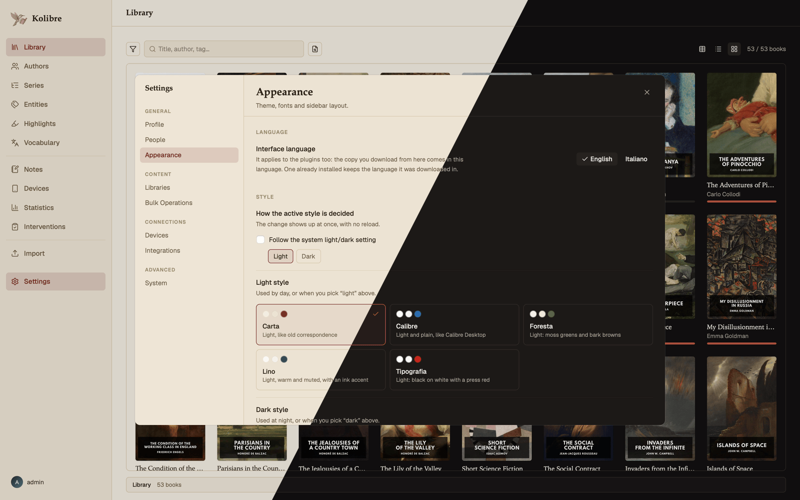

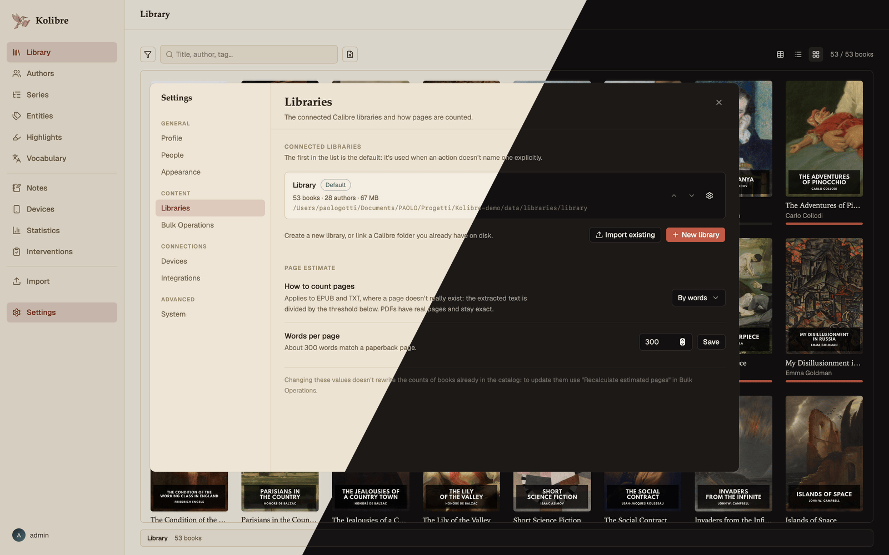

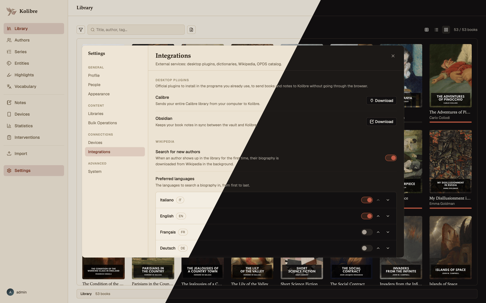

---

## Integrations

### KOReader — the one that matters

This is the piece that makes the whole idea work. The plugin is installed once over USB,
then **updates itself over Wi-Fi** from your own server — on demand, or automatically at
startup if you turn that on.

- **Send and remove books.** You choose on the server; the device applies it at the next
  sync. Removals can be automatic, confirmed on the device, or never — your choice, per
  device.
- **Sync back everything the device knows**: reading positions, reading statistics,
  highlights and notes, and the words you looked up.
- **Back up KOReader itself** — its settings, its reading history, its statistics database.
  This was the thing missing everywhere else: the e-reader was the only device with no
  backup.
- **Quick check** — a fast sync that only looks at new and removed books, skipping the full
  round of statistics and annotations. It is the default on startup, because that is the
  moment you want your new book to be there.
- **Automations** — what should happen on startup, on wake, when a book is opened or
  closed.
- **Browse the library from the device** — the catalogue, with covers, on the e-reader.
  *(Honestly: against the philosophy above. It is there because sometimes you want it.)*
- **Initialize library** — the command for a device you have been using for years. It walks
  every book already on the e-reader, finds the ones Kolibre does not know about yet, and
  proposes a match against your library. On a device with hundreds of books it takes a few
  minutes, and it is the first thing to run after installing the plugin on a reader with a
  life of its own. Nothing is paired without you saying so.
- **Folder layout for [Project Title](https://github.com/joshuacant/ProjectTitle)** — the file tree is written as an
  author list with portraits, so the cover browser shows a real shelf.

Statistics are sent **incrementally**: a device that has been reading for two years has a
statistics database of several hundred kilobytes, and uploading all of it at every sync was
slow for no reason. Only the new rows travel.

### Calibre — because it is still the best editor

Calibre remains unbeatable for conversion, TOC surgery and metadata editing. Kolibre does
some of that, but not as well, and pretending otherwise would be silly.

The workflow this plugin exists for: you have an EPUB on your computer, you open it in
Calibre, you check it and fix it, and you send it straight into a Kolibre library.

- **Upload library to Kolibre** — the first-run command: it takes an entire Calibre
  library and creates it on the server, covers, formats, custom columns and annotations
  included. You pick which custom columns travel. This is how you start, if what you have
  today is a Calibre library on your desktop and nothing on the server yet.
- **Send to Kolibre library…** — one book or a selection, to any library you can write to
- **Send to Kolibre and delete from here…** — for when Calibre was the workbench, not the
  home. It asks first, naming the library, and it only deletes the books that actually
  reached the server: if a send fails, that book stays in Calibre. The deletion goes
  through Calibre's own delete, so it honours the recycle bin
- **Paired libraries** — keep a local Calibre library and a Kolibre one in step, with a
  diff before anything is applied
- Reads the server's library list, so you never type a path
- Sends covers, formats, custom columns and annotations together

### Obsidian — notes where you actually keep them

Highlights become Markdown in your vault, automatically, instead of being copied over one
at a time. One file per book, in a folder you choose, named by a template
(`{{title}}`, `{{author}}`).

The hard part was never the import. It is what happens *afterwards*: once a note is in the
vault you want to edit it — add links, rewrite it, connect it to something — while new
highlights keep arriving. Those two wishes look like they cancel each other out. Four ideas
hold them together.

**The marker is a border.** At the end of the part a block that Kolibre wrote sits a line
like

```
<!-- kolibre-hl id:n7k2p4m9qt base:6b2138ef69352299 -->
```

It means: above me Kolibre writes, **below me you write and Kolibre does not even read**.
The most common case of all — "I added a line of my own" — stops being a conflict.

**Every highlight has a name that does not move.** `id:` is a durable name, not a database
row number: a row number changes when an orphaned highlight is adopted, when two highlights
are merged, and — measured, not feared — when SQLite reuses a number freed by a deletion,
at which point the marker would quietly point at a different passage.

**A three-way compare.** `base:` is the fingerprint of the passage as Kolibre last wrote
it. From three values — that one, what is in the file now, what is on the server now — come
four cases, and three resolve themselves: a new highlight is added, a passage that changed
in Kolibre is carried over, a passage *you* corrected is left alone. The fourth — changed
on both sides — is yours to decide, and the plugin carries out your decision.

**The server keeps a photograph, not a mirror.** On every sync the plugin reports what it
has; the server writes that down with a timestamp and derives the state from it. It is not
a ledger of what *should* be there — it is an account of what *was* there at 14:32. That
distinction is not academic: a ledger that never looks at the disk is exactly what once put
21 books on a Kindle twice.

**What a note looks like.** The book's own chapter structure becomes nested Markdown
headings, so a highlight sits under the chapter it came from rather than in a flat list.
Each passage carries its page, your reading-device note if you wrote one, a small badge
saying where it came from — the device, Calibre, or Kolibre's own web reader — and a link
that reopens that highlight in Kolibre at the exact spot in the book.

**A file you delete stays deleted.** The plugin used to recreate every file you removed and
put back every highlight you deleted by hand — not out of stubbornness: a photograph cannot
tell you what used to be there, and "this book has no blocks in the vault" is identical,
character for character, to "this book never had a file". The server now also keeps a
delivery ledger: what that vault has received, at least once. A deleted file is not
recreated, because once the delivered-and-removed highlights are excluded there is nothing
left to write in it — and if a genuinely new highlight has arrived meanwhile, the file comes
back **with only that one in it**.

**What you decide, the plugin carries out.** Which books to keep sending, which files to
rebuild from scratch, and who wins a conflict are all decided on the [Notes](#notes) page in
Kolibre; the plugin reads those decisions on its next run. The plugin has one command of its
own in the same spirit, **Reimport everything**, which rewrites every file with the current
format — same warning, same reason.

The plugin updates itself from your own server — a button in its settings, not something
that happens behind your back.

---

### A link you can paste

Every book, author, library and highlight has an address you can copy and put anywhere —
an Obsidian note, a message, a text file you keep on the side:

```
http://your-server:8080/k/library/les-miserables-39e1f730/n/n7k2p4m9qt
```

The readable part is decoration; what actually resolves is the short id at the end of each
segment. The book id is Calibre's own UUID, so the link survives a rename, a move to
another library, and a re-import. The highlight id is a durable name that survives the
database row being rebuilt underneath it.

**A link that no longer resolves does not answer with an error.** It says what happened —
that highlight was deleted, that book is no longer in any library you can see, two
libraries read the same from this address — and offers the nearest thing that does exist:
the book for a missing highlight, the library for a missing book. Truncate a link by hand
and you get the parent, which is the behaviour anyone would expect of an address.

The server works out the base address itself, so the link you copy is one that works from
where you are: a reverse proxy's host and scheme if there is one, otherwise the host you
are browsing from. Nothing is published — every one of these addresses is behind your
login, like the rest of Kolibre.

---

## Install

You need Docker with Compose. Two containers: backend (FastAPI + SQLite) and frontend
(compiled React, served by nginx).

```bash
git clone https://github.com/GottiPaolo/Kolibre.git
cd Kolibre
cp .env.example .env
$EDITOR .env          # ports, data folder, first user
docker compose up -d
```

Then open `http://<your-machine>:8080` (or whatever you set as `FRONTEND_PORT`) and log in
with the credentials from your `.env`.

**What to actually change in `.env`:**

| variable | what it does |
|---|---|
| `FRONTEND_PORT` / `BACKEND_PORT` | exposed ports. Plugins talk to the **backend**, your browser to the frontend |
| `DATA_PATH` | where libraries, databases and device backups live. **Back this folder up** |
| `ADMIN_USERNAME` / `ADMIN_PASSWORD` | the first user, created only on the very first start |

`SECRET_KEY` is optional: leave it alone and Kolibre generates one on first start, keeping
it in your data folder.

### Using a Calibre library you already have

A Kolibre library **is** a Calibre library: same `metadata.db`, same folder structure. You
can point it at an existing one without converting anything — uncomment the mount in
`docker-compose.yml`:

```yaml
- /real/path/to/your/library:/external-library
```

then import it from **Settings → Libraries**. Nothing is copied: Kolibre points at the
folder where it already is, and Calibre Desktop can keep opening it at the same time.

---

## Large libraries

Kolibre is built for a library you actually have, which for most people is a few thousand
books. Past that it starts asking the server to do more work and the browser less, and all
of it is **visible and switchable** in *Settings → System → Large libraries*. The numbers
below were measured against a test library of 100,000 books.

**Three independent paginations**, each with three modes — automatic past a threshold,
always, never:

| What | Past the threshold | If you turn it off |
|---|---|---|
| **Library** | The page asks the server for one page at a time, and search and sorting run in SQLite across the whole library | It downloads the entire catalogue. With tens of thousands of books that is slow |
| **Authors** | It draws N cards at a time | A card for every author: at twenty thousand authors that is 180,000 DOM nodes and a search that takes twelve seconds |
| **Import** | One page of pending files at a time | A card for every pending file |

The thresholds and page sizes are yours to set. The important part is that past the
threshold **search and sorting still cover the whole library**, not the page you are looking
at — a paginated view that silently searches only what it has loaded is worse than no
pagination at all.

**Full-text search has a cap, and you choose it.** The index holds the text of every book
and weighs roughly 1.5 MB per book: at 100,000 books that would be over 150 GB. Set a cap in
gigabytes and indexing stops when it is reached — nothing already indexed is deleted, and
everything in the index stays searchable. `0` means no cap. You can also leave full-text
search off entirely: everything else works without it.

**Statistics are precomputed** in the background rather than recalculated every time you
open the page, and catalogue counts are done in SQL rather than by downloading the catalogue
to count it in the browser.

None of these is a hidden limit. Every one of them says, in the settings page itself, what
it costs to switch it off — because the honest version of "it gets slow with a lot of books"
is a number and a switch, not a disclaimer.

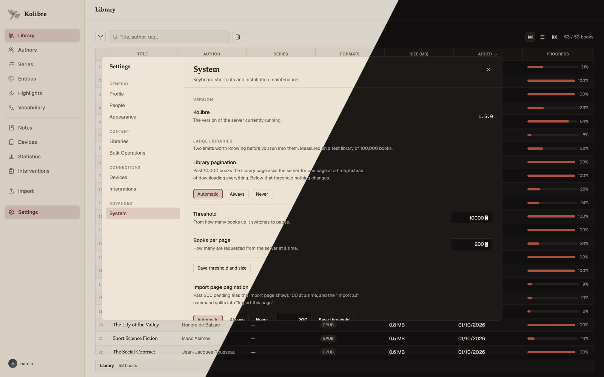

---

## Roadmap

Where this is heading next. Three things, no dates:

- **A web reader worth reading in.** Today it is for checking a passage; it should be able
  to hold a novel, with the same position sync and the same highlights as a device.
- **A real interface on KOReader.** The plugin works through KOReader's own menus, which is
  the cheap way in. A purpose-built screen for the library, the sync and the queue would make
  the device side feel like one piece with the server instead of a settings tree.
- **A client that is not a browser.** The backend already serves nothing but JSON, files and
  OPDS, so a native application — macOS, Windows, Linux, Android — could talk to it with no
  web app in front of it. That is the reason for the split, and it is the point at which it
  pays for itself.

---

## A note of modesty

This was built by one person, for one person's reading habits. It solves problems I
actually had. It may not solve yours, and it certainly does not solve them the way a team of
ten would have.

The parts I am least sure about are the ones I use least — the web reader, the Obsidian
flow, anything involving more than two users. If something looks wrong, it probably is.

---

## Project status

**Not stable.** It changes often, and some parts are clearly more finished than others.
The database migrates forward but not backward.

If you want to use it: **back up your data folder**, and do not trust it blindly.

**And it was written with an AI**, which is worth saying plainly rather than leaving you to
work it out. Four months of long sessions in which I decided what should happen, argued about
how, and read what came back. It is the reason a program this size exists at all, built by
one person alongside everything else, and it is a fair thing to know before you hand it your
library. What it is not is code nobody looked at: the design decisions in here are ones I
defended, the tests are real tests that fail when the thing they test is broken, and where I
could not check something this page says so — the parts called rough above are rough.

### Security

Kolibre is built for a home network. Before exposing it to the internet, read
[SECURITY.md](SECURITY.md) — it says plainly what is protected, what is not (there is no
rate limiting on login, among other things), and how to report a problem.

### Credits

Kolibre stands on other people's work:

- **[Calibre](https://calibre-ebook.com)** — the library format, and the algorithms that
  produce identical sort keys and folder names. Kolibre ports them, and says where.
- **[KOReader](https://github.com/koreader/koreader)** — the only e-reader software open
  enough to make any of this possible.
- **[Project Title](https://github.com/joshuacant/ProjectTitle)** — the cover browser the folder layout is shaped
  for.
- **[Wikipedia](https://www.wikipedia.org) and [Wikidata](https://www.wikidata.org)** —
  author biographies and facts.
- **[Standard Ebooks](https://standardebooks.org)** — the beautifully produced public
  domain editions used in the screenshots on this page. Go and look at what they do; it is
  a remarkable project.

### Contributing

The discussion I would most like to have is **not about the code**. It is about the
philosophy above: reading with digital tools has enormous advantages that almost nobody
exploits. If you have ideas, objections, or a completely different way of seeing it,
**issues are the right place** — more than pull requests, for now.

---

## Repository layout

```
backend/          FastAPI + SQLAlchemy + SQLite; talks directly to Calibre's metadata.db
frontend-react/   React + TypeScript + Tailwind; static build served by nginx
plugins/
  koreader/       KOReader plugin (.koplugin, Lua) — full sync
  calibre/        Calibre Desktop plugin (Python/Qt) — "Send to Kolibre library…"
  obsidian/       Obsidian plugin — highlights as Markdown in your vault
docs/immagini/    the screenshots on this page
```

## License

[GNU AGPL-3.0-or-later](LICENSE). Kolibre contains code derived from Calibre (GPL-3.0) and a plugin
that lives inside KOReader (AGPL-3.0) — [NOTICE](NOTICE) lists exactly what comes from
where, and why the licence is what it is.
